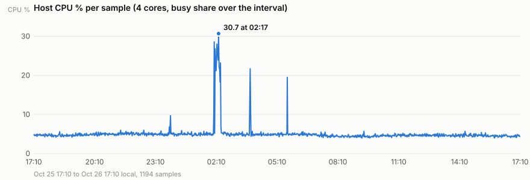
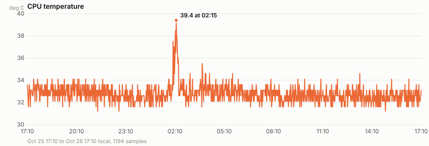
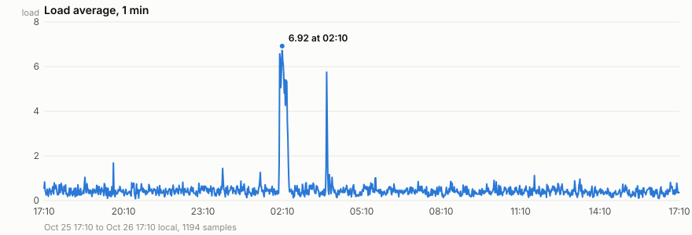
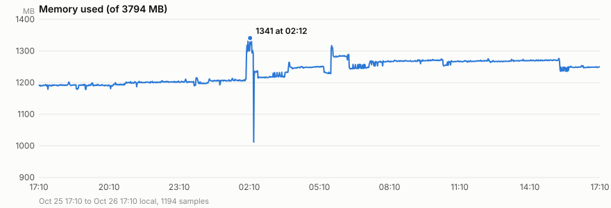
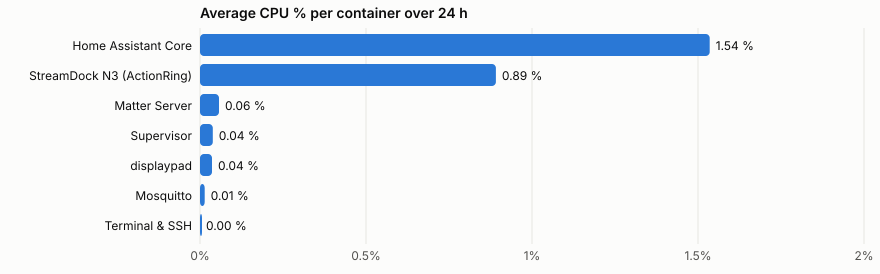
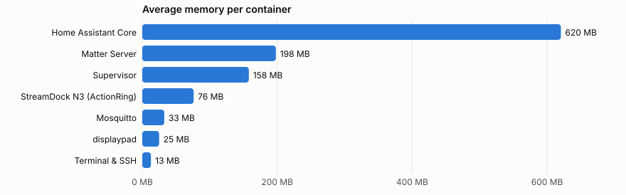

# Home Assistant Pi: 24-hour performance profile

Sampled from 2026-10-25 17:10 to 2026-10-26 17:10 local time with
`/share/sysmon/sysmon.sh` running in the Terminal & SSH app on the Pi
(Raspberry Pi 4, HAOS, 4 cores, 3794 MB). 1194 host samples and 7861
container samples; the achieved interval was a median 73 s (71 to 96 s),
not the nominal 60 s, because each round of Supervisor stats calls takes
about 13 s. Raw data: `host-20261025-1709.csv` and
`containers-20261025-1709.csv` under `/share/sysmon/` on the Pi.

Host figures come from `/proc/stat`, `/proc/loadavg`, `/proc/meminfo` and
the CPU thermal zone; container figures from `ha core stats`,
`ha supervisor stats` and `ha apps stats <slug>`. An app container cannot
see the host's process list, so "heaviest process" is measured per
container, which is what HAOS exposes.

## Summary

| Metric | Min | Average | Max | When |
|---|---|---|---|---|
| CPU temperature | 31.2 °C | 32.8 °C | 39.4 °C | 02:15 |
| CPU busy % | 4.0 | 5.0 | 30.7 | 02:17 |
| Load, 1 min | 0.1 | 0.5 | 6.9 | 02:10 |
| Load, 15 min | 0.3 | 0.5 | 4.1 | 02:20 |
| Memory used | 1012 MB | 1237 MB | 1341 MB | 02:12 |
| Processes | 659 | 667 | 681 | 02:10 |

The box idles at about 5 % CPU and 33 °C, with 2.5 GB free. The whole
day's load sits in one burst, 02:04 to 02:22 on Oct 26, when Home
Assistant Core ran up to 20.9 % on its own and the load average reached
6.9 on four cores. It was not a backup (the automatic backups ran at 05:40
both days) and the cause is not identified from these samples.

## Host over time

## Containers

| Container | Avg CPU % | Peak CPU % | Avg memory MB | Peak memory MB | Samples |
|---|---|---|---|---|---|
| Home Assistant Core | 1.54 | 20.9 at 02:22 | 620 | 649 | 1194 |
| StreamDock N3 (ActionRing) | 0.89 | 4.5 at 16:48 | 76 | 83 | 1194 |
| Matter Server | 0.06 | 1.6 at 23:31 | 198 | 245 | 1194 |
| Supervisor | 0.04 | 15.6 at 00:27 | 158 | 183 | 1194 |
| displaypad | 0.04 | 0.1 at 17:13 | 25 | 31 | 696 |
| Mosquitto | 0.01 | 0.1 at 05:02 | 33 | 66 | 1194 |
| Terminal & SSH | 0.00 | 0.0 at 17:10 | 13 | 27 | 1194 |

Home Assistant Core is the heaviest container by every measure. The
ActionRing app (StreamDock N3) is second on CPU at under 1 % and a steady
76 MB; its 4.5 % peak at 16:48 coincides with the scrub experiments of that
afternoon. The Supervisor's single 15.6 % spike at 00:27 is its own
housekeeping. The displaypad app has 696 samples instead of 1194: it stopped
reporting at 07:19 on Oct 26 (its device read failed and the app exited;
the Supervisor shows it in an error state).

## Hourly profile

| Hour (local) | CPU % | Temp °C | Load 1 min |
|---|---|---|---|
| 25 17h | 4.7 | 33.0 | 0.47 |
| 25 18h | 4.6 | 32.9 | 0.39 |
| 25 19h | 4.8 | 33.0 | 0.44 |
| 25 20h | 5.0 | 33.0 | 0.43 |
| 25 21h | 5.1 | 32.8 | 0.41 |
| 25 22h | 5.1 | 32.6 | 0.43 |
| 25 23h | 5.1 | 32.4 | 0.49 |
| 26 00h | 5.0 | 32.6 | 0.44 |
| 26 01h | 4.9 | 32.7 | 0.45 |
| 26 02h | 11.0 | 34.2 | 2.03 |
| 26 03h | 5.5 | 33.0 | 0.67 |
| 26 04h | 4.9 | 33.0 | 0.42 |
| 26 05h | 5.2 | 33.0 | 0.45 |
| 26 06h | 4.9 | 32.8 | 0.42 |
| 26 07h | 4.6 | 32.7 | 0.41 |
| 26 08h | 4.4 | 32.5 | 0.41 |
| 26 09h | 4.4 | 32.6 | 0.38 |
| 26 10h | 4.6 | 32.6 | 0.43 |
| 26 11h | 4.7 | 32.6 | 0.42 |
| 26 12h | 4.7 | 32.6 | 0.45 |
| 26 13h | 4.7 | 32.6 | 0.40 |
| 26 14h | 4.7 | 32.4 | 0.34 |
| 26 15h | 4.6 | 32.5 | 0.38 |
| 26 16h | 4.5 | 32.6 | 0.38 |
| 26 17h | 4.6 | 32.5 | 0.44 |

## Method notes

- CPU % is the busy share of all four cores between two samples, from the
  `/proc/stat` deltas; a single-threaded burst therefore shows as at most 25 %.
- Container CPU % is the Supervisor's own figure (Docker stats), so the
  per-container numbers and the host figure are not the same scale.
- The sampler script and this report's charts (plain SVG, one series per
  chart, no dual axes) are reproducible: `sysmon.sh` takes `INTERVAL` and
  `HOURS`; the charts were rendered from the CSV files with a short Python
  script, no plotting library.
